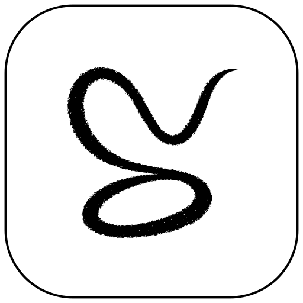
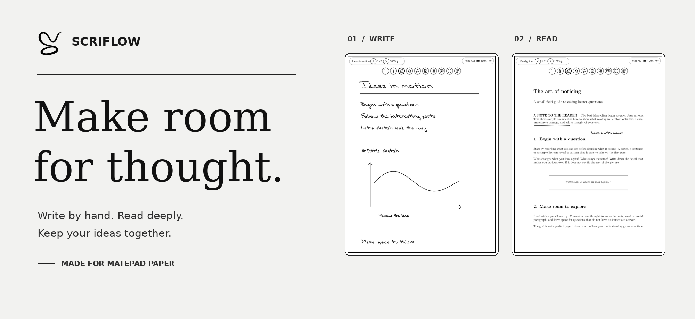
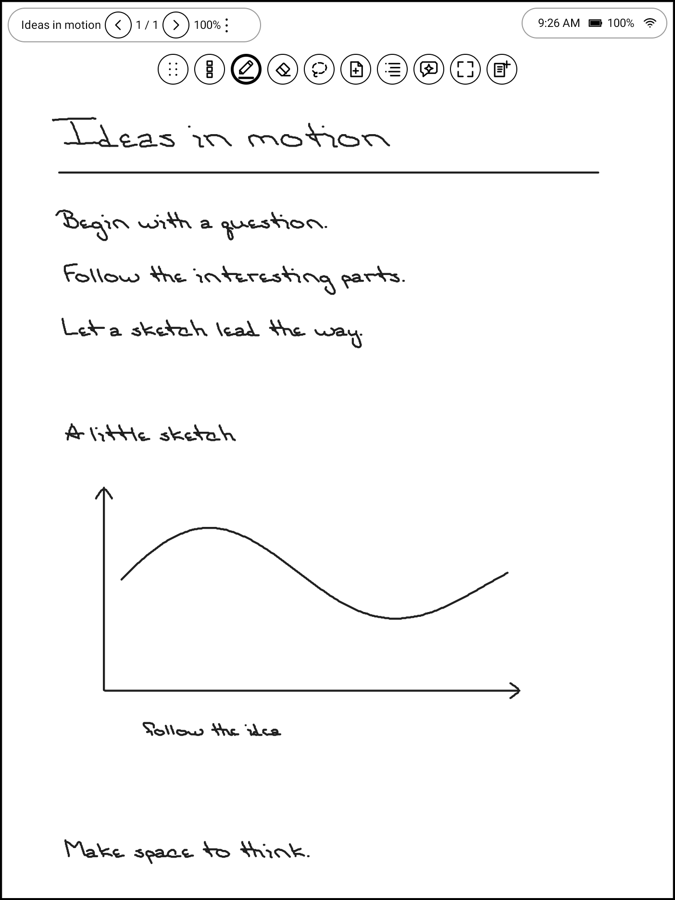
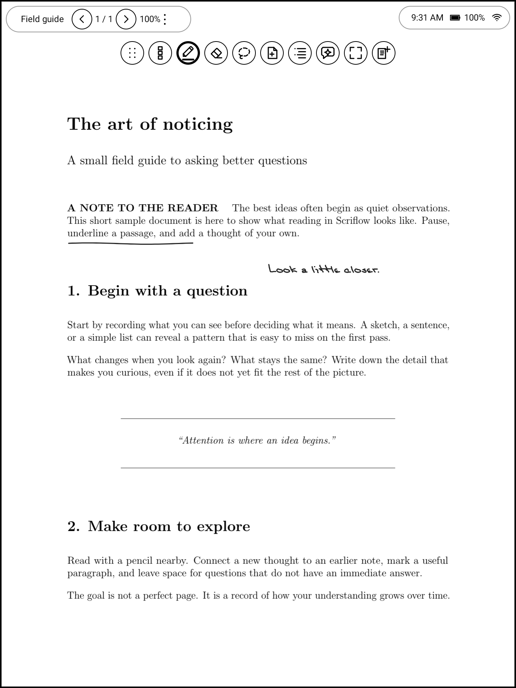
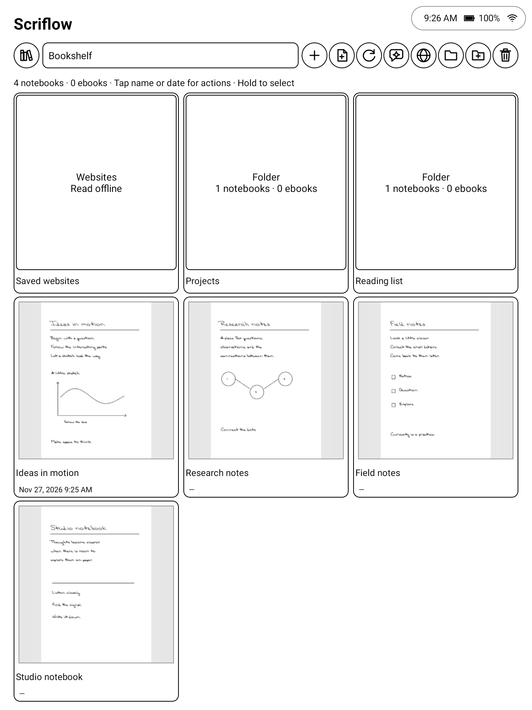
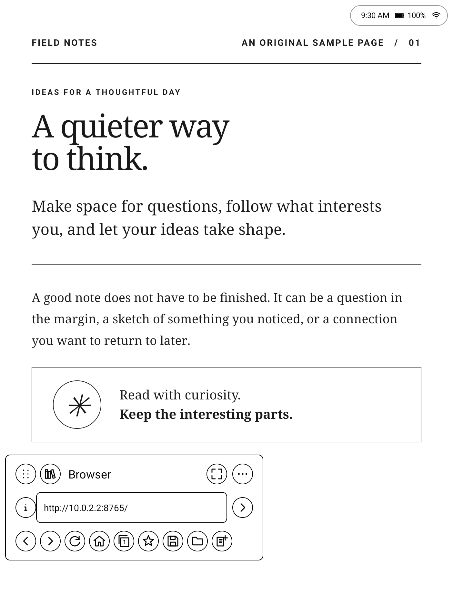

<p align="center">
  
</p>

<h1 align="center">Scriflow</h1>

<p align="center">
  <strong>Handwriting for thinking.</strong><br>
  A quiet workspace for notes, reading, and the ideas in between.<br>
  Made for the Huawei MatePad Paper.
</p>

<p align="center">
  <strong><a href="https://github.com/xing-phys/Scriflow/releases/tag/v0.49.0-rc.1">Get the release candidate</a></strong>
  &nbsp; · &nbsp; <a href="https://github.com/xing-phys/Scriflow/releases/latest">Stable release</a>
  &nbsp; · &nbsp; <a href="docs/user-guide.md">User guide</a>
  &nbsp; · &nbsp; <a href="#build-and-contribute">Contribute</a>
</p>



Scriflow brings handwriting, documents, books, and the web into one e-ink workspace. Sketch an idea, write in the margins of a PDF, keep a reading notebook nearby, and return to it all from your bookshelf. Your notes live on your tablet; there is no Scriflow account or cloud sync.

## See it in action

<table>
  <tr>
    <td width="50%" valign="top">
      
      <br><strong>Write and explore</strong><br>
      Give a question, calculation, or sketch room to grow.
    </td>
    <td width="50%" valign="top">
      
      <br><strong>Read with a pen</strong><br>
      Add handwriting to PDFs and export a copy with your annotations.
    </td>
  </tr>
  <tr>
    <td width="50%" valign="top">
      
      <br><strong>Keep it together</strong><br>
      Find notebooks and books in a bookshelf with nested folders.
    </td>
    <td width="50%" valign="top">
      
      <br><strong>Follow your curiosity</strong><br>
      Browse the web, save pages for offline reading, and keep notes close.
    </td>
  </tr>
</table>

<sub>Screenshots show the 0.49.0 release candidate on an Android emulator with original sample content. The sample handwriting uses synthetic strokes and an emulator software pen; it does not demonstrate physical stylus latency or pressure. The browser displays a locally hosted sample page.</sub>

## A workspace for curious minds

- **Write naturally.** Use pressure-sensitive handwriting, blank or lined paper, adjustable pen and eraser tools, lasso selection, images, and Markdown blocks. Choose standard or custom paper sizes, zoom, and organize pages as you work.
- **Read and annotate.** Open a PDF as a notebook, write on its pages, navigate its outline, and export the original document with vector annotations. Read DRM-free EPUB, MOBI/AZW3, DjVu, FB2, CBZ, HTML, and TXT books with adjustable reading settings and linked handwritten notes. [PDFs](docs/pdf-reading.md) · [Ebooks](docs/ebook-reading.md)
- **Think across pages.** Open notes in split or floating windows, arrange the movable toolbox, and keep a reference beside the page you are working on.
- **Organize your work.** Browse notebooks and ebooks in list or thumbnail view, create nested folders, recover items from Trash, and manage tablet files in the built-in Files browser. [Bookshelf](docs/bookshelf-settings.md) · [Files](docs/file-manager.md)
- **Explore beyond the page.** Use the built-in browser, save individual pages for offline reading, download files, and manage downloads. Optional AI chat connects to a provider you configure and keeps local conversation history. [Browser](docs/browser.md) · [AI chat](docs/ai-chat.md)
- **Share your view.** Cast the visible app screen to a browser on the same trusted Wi-Fi network. [Screen cast](docs/screen-cast.md)

## Compatibility and status

Scriflow is developed and physically tested for the **Huawei MatePad Paper HMW-W09**, running **Android 10 / API 29** and firmware **HMW-W09 2.1.0.222(C00E170R1P8)**. Its native handwriting and pressure rendering rely on Huawei APIs supplied by that firmware. Other devices and firmware versions are unverified.

The screenshots and feature overview describe **[0.49.0-rc.1](https://github.com/xing-phys/Scriflow/releases/tag/v0.49.0-rc.1)**, a release candidate. The RC has been checked on the target tablet and in an emulator; full physical acceptance of all changes is still in progress. The latest stable release is **[0.33.2](https://github.com/xing-phys/Scriflow/releases/tag/v0.33.2)** and does not include all features shown above. See the [RC notes](docs/releases/0.49.0-rc.1.md) and [changelog](CHANGELOG.md) for details.

## Install and update

For two-way file and link transfer, see [Wi-Fi Sharing in 0.50.0-alpha.1](https://github.com/xing-phys/Scriflow/releases/tag/v0.50.0-alpha.1) and the [sharing guide](docs/wifi-sharing.md).

1. On the supported tablet, download the signed **[0.49.0-rc.1 APK](https://github.com/xing-phys/Scriflow/releases/download/v0.49.0-rc.1/scriflow-0.49.0-rc.1.apk)** and its **[SHA-256 checksum](https://github.com/xing-phys/Scriflow/releases/download/v0.49.0-rc.1/scriflow-0.49.0-rc.1.apk.sha256)**, or choose the [stable release](https://github.com/xing-phys/Scriflow/releases/latest).
2. Open the APK on the tablet and follow Android's installation prompts. To update an existing installation, use an APK signed with the same certificate; do not uninstall the app to update it.
3. In the RC, open **Settings → About** to see the installed version and check for updates. You can include preview releases and choose whether to delete a downloaded installer after a successful update. Scriflow verifies the download before Android asks you to confirm installation. [Update details](docs/updating.md)

**Back up before updating.** Export each notebook as an editable `.inkbook` backup and keep copies outside the app. A PDF export is a sharing copy, not an editable notebook backup. Backups are unencrypted, and ebook originals, reading state, saved websites, and chat history are separate from notebook backups. Uninstalling Scriflow or clearing its app storage deletes its private data. Newer releases can write formats older APKs cannot read, so keep backups before updating and avoid downgrading without a recovery plan. [Privacy and storage](docs/privacy.md) · [Release signing](docs/releasing.md)

## Get started

1. Open a notebook from the bookshelf or tap **+** to make one. Quick notes use A5 paper; named notebooks can use a preset or custom size.
2. Write with the stylus, scroll with a finger, and pinch to zoom. Drag the dotted grip to move the toolbox; tap it to collapse or expand the tools.
3. Open a PDF or supported ebook from **Files**. Use the bookshelf folders to organize it alongside your notes.
4. Make an editable backup from a notebook's actions and save it somewhere independent of the app.

The [user guide](docs/user-guide.md) explains more controls and workflows; some sections predate the current release candidate. The [documentation directory](docs/) contains focused guides for individual features.

## Privacy and practical limits

Notes work locally. Scriflow has no advertising, analytics, app account, or cloud sync. The browser contacts sites you visit; optional AI chat sends only what you submit to your configured provider, whose policies then apply. Casting uses password-protected local HTTP, which is **not encrypted**; use trusted Wi-Fi. See [privacy and local storage](docs/privacy.md) for details.

Ebooks must be DRM-free. Scriflow does not perform OCR or handwriting recognition. PDF imports support up to 2 GiB and 1,000 pages; larger notebooks and long sessions may be constrained by device resources. See the linked reader guides for format and feature limits.

## Build and contribute

Contributions and thoughtful bug reports are welcome. On Linux x86_64, the project's development workflow starts with:

```bash
./scripts/bootstrap-gradle.sh
./scripts/test.sh
./scripts/build.sh
```

See [Building](docs/building.md) for prerequisites, Gradle and test options; [Contributing](CONTRIBUTING.md) for project conventions; and [Architecture](docs/architecture.md) for the design. Share a reproducible problem or suggestion through [GitHub Issues](https://github.com/xing-phys/Scriflow/issues/new/choose). The [branding guide](docs/branding.md) explains the name and artwork.

## License

Scriflow's source code and documentation are available under the [MIT License](LICENSE). The Scriflow icon and its derived branding are © 2026 Xing, all rights reserved, and are **not** licensed under MIT; see the [icon rights notice](LICENSE-ICON.md). Bundled dependencies retain their own licenses; see [Third-party notices](THIRD_PARTY_NOTICES.md).
