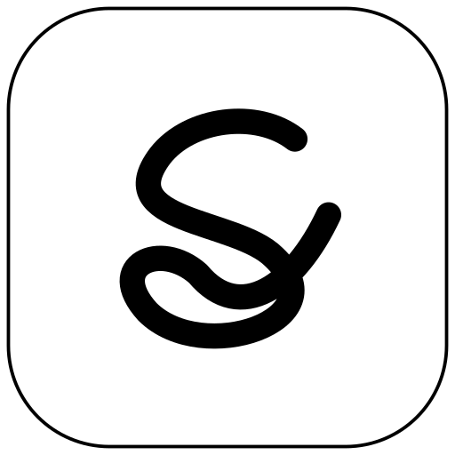

# Scriflow



**Handwriting for thinking.**

Scriflow brings together *scribe*, *script*, and *scribble* with *flow*: a quiet
place to draft, calculate, work through a derivation, and follow an idea. It is
a notebook app for the **Huawei MatePad Paper**, formerly named
**Scribblow**.

## Compatibility and status

Development and physical testing target **MatePad Paper HMW-W09**, Android
10/API 29, firmware **HMW-W09 2.1.0.222(C00E170R1P8)**. Handwriting and pressure
rendering use Huawei APIs already present on that firmware; no proprietary
Huawei code is bundled. Other tablets and firmware versions are unverified.

The latest stable release is **[Scriflow 0.33.2](https://github.com/xing-phys/Scriflow/releases/tag/v0.33.2)**,
released on 2026-10-29. It adds compact interactive note navigation, writing-only
history icons, a Zen clock mode, direct figure picking, inline figure editing
with arbitrary rotation and cross-page dragging, and icon-only action strips.
It retains figures/lasso export, two split panes plus multiple floating notes,
the toolbox notes tray and stylus-tap editing focus. Inactive notes scroll and
pinch continuously; ink and PDF tiles render at the current zoom. The toolbox
stays in front, window operations retain the main editor, and PDF import opens
the file picker directly before opening the imported note.

The **[0.40.0-alpha.1 prerelease](https://github.com/xing-phys/Scriflow/releases/tag/v0.40.0-alpha.1)**
adds a **Browser** shortcut and a permanent **Saved websites** folder to the
bookshelf. Browse HTTPS websites with Android's Chromium-based WebView, then
tap **Save** to keep the current page, including captured images and styling.
Open saved pages from the folder without Wi-Fi; the offline reader blocks
network loads and scripts. Each save captures one page, rather than crawling
linked pages. See [Browser and offline websites](docs/browser.md) for controls
and capture limits. This alpha awaits tablet testing; its signed APK and
checksum are on the release page.

It also retains the independent AI workspace from 0.39:
open a new or saved AI chat from the bookshelf in its own workspace, with no
notes open. Choose a floating note from the toolbox when needed; closing or
minimizing the main chat returns to the bookshelf. Active floating-note corner
controls and the lasso action bar use separate layers above the writing surface.
The shared top status bars now stay above floating notes in this workspace,
with the toolbox and floating chats still above them.
This alpha also includes
streamed AI replies and named provider profiles. Multi-selection in Trash
supports permanent deletion after confirmation. The outline opens at the current
heading, and the bookshelf and Settings share the note's status pill. This alpha awaits tablet
testing; its signed APK and checksum are on the release page. Chats made with
newly added profiles use a header that earlier APKs cannot read; see
[AI chat](docs/ai-chat.md) for compatibility details.

The **[0.35.0-alpha.8 prerelease](https://github.com/xing-phys/Scriflow/releases/tag/v0.35.0-alpha.8)**
adds [PDF reading controls](docs/pdf-reading.md): auto/manual/semi-auto cropping,
odd/even crop areas, optional single-page reading with zoom, adjustable PDF
contrast, and long-press word selection with Eudic floating lookup. Continuous
scrolling at Fit width remains the default. Crop and contrast affect display;
original PDF bytes, saved annotation coordinates and PDF exports are preserved.

The **[0.37.0-alpha.6 prerelease](https://github.com/xing-phys/Scriflow/releases/tag/v0.37.0-alpha.6)**
adds a per-block Markdown preview font control and fixes raw-text vector layout
and resize preview scaling. It retains the compact chat composer, independent
chat and Markdown text-size defaults, and more stable undo/redo controls. It retains freely resizable,
reflowing Markdown blocks and whole-notebook attachments. It also
protects [bursts of handwriting](docs/handwriting-priority.md) from automatic
history, Markdown, chat, clock and inactive-note display updates. These updates
catch up after native input settles and a 300 ms quiet interval; pen drawing
and background stroke saving continue immediately. Physical latency acceptance
remains pending. It retains multiple floating [AI chats](docs/ai-chat.md), using
the same window controls as floating notes.
Configure a provider, model and API key in Settings, then tap the chat-bubble
sparkle in the toolbox for a movable, resizable conversation window. Replies
reuse the existing offline Markdown/math/code renderer. Presets cover OpenAI,
Anthropic, Gemini and DeepSeek, with a custom OpenAI-compatible HTTPS option.
Fetch available models using your URL and key in Settings. Models appear directly
below Fetch as names with checkboxes and settings gears. Check the ones you want,
then **Save AI settings**. Each gear opens automatically filled limits, image
support and thinking options for optional manual edits; **Use fetched defaults**
resets those edits. Tap the model name at the bottom of a chat
to choose a saved model for a new session. Append selected handwriting,
images or Markdown with the chat icon in their selection controls, then press
Send. Only submitted chat text, selected attachments and their conversation
history are sent. Use the toolbox AI icon for a tray with **+**, **History** and
minimized chats. History works even with no windows open. The window has a
compact message row with **+** for a notebook attachment, a model picker and a
send arrow. Longer messages expand into a full-width editor above the controls.
Copy the last reply from the bottom-left
options menu. Tapping an overlapping floating chat or note brings it to the
front. Each new window has its own session,
draft and model. Tap the bottom-left
corner for options or drag it to move; tap the bottom-right corner to minimize
or drag it to resize. The same thin outline as notes follows the gesture,
keeping the top-left corner fixed; content refits on release. All four borders
retain the separate clipped frame. Position menus include Left, Right, Top,
Bottom and Floating window; a docked chat reserves space beside the notes.
Use the tray's history icon to reopen or delete earlier sessions; reopening an already
open session focuses its window. Closing keeps history, and minimized chats
retain in-progress replies. Windows and minimized states restore across app
reopen, rotation and Settings. Tablet acceptance remains pending.

The owner confirmed clear stationary Markdown and figure dragging in alpha.3/4.
Alpha.5 keeps page rendering in one persistent regular View through scrolling,
zooming, Zen changes and writing, with transparent native live ink above it.
This removes the remaining switches back to distorted native paper. The new
composition and live writing still need physical tablet confirmation.

The toolbox now shows separate, spaced circular buttons without a shared bar.
The top-left menu opens detached circles to the right of the note bar; the
three dots disappear and the bar shortens while they are open. Tap figures
directly to manipulate them. Undo/Redo float beside the right status pill. The compact Zen clock has a transparent inner
background, leaving its rounded container visible.

Tap the selected Eraser icon to choose Stroke or Region mode. Region mode draws
a dashed loop like Lasso and erases whole selected handwriting strokes on lift,
including strokes crossing the loop boundary. Figures and PDF content remain.
The choice is remembered; the width slider applies to Stroke mode.

It also includes editable [Markdown blocks](docs/markdown-blocks.md) with offline
MathJax, tables, code, diagrams and CJK fonts. Pages with newly rendered or
individually sized Markdown use **page format 9**; other pages continue to use
format 8. Older APKs cannot read format-9 pages or backups containing them.
Preserve independent backups before updating.
The new reading and Markdown interactions await tablet acceptance; 0.33.2
remains the latest stable release. Download the alpha's signed APK and SHA-256
file from its release page.

Double tapping the **M-Pencil body** switches Pen/Eraser and briefly shows the
selected icon at the top center. The owner accepted the physical switches and
icons. Earlier connected-tablet checks cover landscape PDF import, multiple floating
notes, lasso panels, native rendering, sleep/wake and Home/return. The small-pane
PDF cache fixture uses 64% fewer pixels and releases hidden native readers; see
the [MatePad audit](docs/matepad-audit-0.33.md) for measurements and limits.
Other hardware/firmware, overnight battery drain, cover-sensor behavior and
optical latency remain unverified.

The application ID and permanent signing certificate are retained for in-place
updates. **0.33.2 writes page format 7 on edit and in new editable backups. Older
APKs, including 0.33.1, cannot read those pages or new backups.** Existing page
versions 1–6 and old backups remain readable without rewriting pages on open.
Keep independent editable backups before updating. See [figures and workspace](docs/figures-and-workspace.md),
[changelog](CHANGELOG.md), and [device records](docs/device-testing.md).

**0.33.2** makes the top-left bar compact and interactive: tap the note name
for the bookshelf, the page counter for page management, or the percentage for
zoom. Previous/next arrows flank the counter, and the three dots expand into
function icons in the same bar. Undo/Redo live beside the right status bar and
appear individually after writing; other interactions hide them until writing
resumes. The toolbox Zen toggle hides the left bar and history while retaining
a tiny clock with seconds. Tap again to restore the normal display.

Insert figure opens the picker directly and returns to the note. Select a figure
to move, resize, rotate freely, or copy/cut/delete using nearby icons. Drag across
pages with edge scrolling, then tap outside to finish. Lasso actions also use
icons and outside-tap dismissal, without a Done button. See the
[navigation record](docs/compact-note-navigation.md), [history controls](docs/writing-history-controls.md),
[Zen mode](docs/zen-mode.md), [inline figures](docs/inline-figures.md) and
[action icons](docs/icon-actions.md).

The final APK passed **248,470 host assertions in 68 suites**, debug/release
lint and builds, and permanent-signature checks. Its DEX code matches dev.6;
release promotion changes only version and documentation metadata.
**This exact APK and the latest UI/figure interactions remain physically
untested**, following the owner's instruction to continue without the tablet
and explicit authorization to release. Earlier connected results do not replace
acceptance of this APK. See [release notes](docs/releases/0.33.2.md) for scope and limits.

## Features

- Native handwriting with adjustable pen thickness, page/screen width modes,
  and pressure-preserving ink.
- Multiple named notebooks, folders and recoverable Trash, compact list/thumbnail
  bookshelf layouts, blank/lined pages, continuous finger scrolling,
  thumbnail overview, and direct page jumps.
- A5 by default for new notes, standard paper sizes and custom dimensions,
  with matching physical PDF page sizes.
- Two-finger zoom, a percentage indicator, and fit width/height/page choices.
- Portrait, landscape, or automatic sensor rotation from Settings.
- Stroke eraser with an adjustable grey trail, or Region eraser with a dashed
  loop; both remove whole selected strokes and support undo/redo.
- Native dashed lasso to select whole strokes on any overlap, move them across
  pages, duplicate, copy/cut/paste, or delete them, with nearby actions and
  finger/stylus dragging.
- Manage pages from the overview: reorder, duplicate, insert blank pages, delete,
  and undo/redo page changes.
- Insert images, then move between pages, resize, rotate freely or delete them
  with undo; include figures in thumbnails, PDF exports and editable backups.
- Export selected ink as SVG, PNG, JPEG, WebP or PDF.
- Keep up to two split notes and several floating notes open with one shared toolbox.
  Tap a note with the stylus to edit it; finger-scroll or pinch any note, and
  minimize/restore windows through the toolbox notes tray.
- Automatic saving of completed strokes and editable restoration after reopening.
- Vector PDF export for sharing and editable `.inkbook` backup/restore.
- Import PDFs as notebooks, write over their original pages, follow links,
  and export with original PDF content plus vector ink.
- Imported and editable note outlines, with previous/next view navigation.
- Compact circular tools in a movable, rotatable, collapsible dock, plus floating
  notebook and time/battery/Wi-Fi islands over a full-screen page.
- Optional floating AI chat with configurable provider/model/endpoint, encrypted
  API-key storage, automatic model specifications, saved sessions to reopen/delete
  and Markdown/math replies.

Notes stay on the tablet. Scriflow has no app account, analytics, or cloud sync.
Optional AI chat sends the text and selected attachments you submit, and that chat's history, directly to
your configured provider. See [privacy and local storage](docs/privacy.md).

## Install and update

Download the signed **[Scriflow 0.33.2 APK](https://github.com/xing-phys/Scriflow/releases/download/v0.33.2/scriflow-0.33.2.apk)**
from [GitHub Releases](https://github.com/xing-phys/Scriflow/releases/tag/v0.33.2),
where its file checksum and signing certificate fingerprint are recorded.
Copy it to the supported tablet, open it with the tablet's file manager, and
allow installation from that source when prompted.
Open **Scriflow** from the launcher. Review the app version and signing
certificate supplied with a release before installing it.

**Back up your notes before an update or a change of signing identity.** In the
library, choose **Backup** beside each notebook and save its `.inkbook` file
outside the app's private storage. Try **Restore backup** to confirm it opens
as a separate notebook. PDF export is a reading copy, not an editable backup.

An ordinary update must keep the same application ID and signing certificate.
The application ID remains `org.eink.inkprobe`, and the existing public signing
key is retained, so the Scriflow rename can update the released Scribblow app
in place without moving notebooks. If Android rejects an update because its
signature differs, stop and follow the [signing migration instructions](docs/releasing.md#moving-from-a-development-key).
**Uninstalling the app or clearing app storage deletes its private notes.**
Version 0.32 writes version-2 library catalogs with folder/trash metadata on the
next catalog change. Earlier APKs cannot read an upgraded library; preserve
editable backups before updating. Page and backup formats are unchanged.
Version 0.31-dev.2 writes version-5 pages retaining the exact native width and
capture scale of new strokes; older APKs cannot read these pages. Existing page
versions 1–4 remain readable and are not rewritten on open. Old strokes' capture
scale was never recorded and cannot be recovered reliably. Version-2 editable
backups include PDF assets and outlines. Version 0.30 added physical paper dimensions. Opening an existing page
keeps its stored coordinates and previous PDF printing scale.
Version 0.29 introduces a version-2 page-order index
when page management is first used; earlier APKs cannot open that managed book.

## Start writing

Open **My Notebook** or choose **+ Notebook**, select a paper size, and create
the note. New notes default to A5 and open fitted to the screen width. Pinch
with two fingers to zoom. Write with the stylus and drag with one finger to
scroll. The top-left **⋮** menu switches blank/lined backgrounds;
the page-plus icon inserts a page after the current page. The grid opens page thumbnails.

Tap an already-selected Pen or Eraser icon to adjust its width. Drag the
six-dot grip to move the tools, tap it to collapse/expand them, or use the
direction icon to rotate them.
Use **Import PDF** in the library to make a PDF notebook. The outline icon
opens imported headings and lets you add your own; the disclosure arrows fold
nested headings. Finger taps follow PDF links. Previous/next view icons appear
at the lower right only when available, or beside a floating note's minimize
control. Links, outline jumps and page-overview jumps enter view history;
ordinary scrolling, zoom, and page buttons do not. Both stacks survive rotation.
Settings offers **Fixed width on page** (default), using native width fitting,
and **Fixed width on screen**, keeping the nib's screen size while writing.
Both use direct native AHW. Page mode's native pressure response can vary with
zoom; identical pressure behavior across zoom is unresolved. Completed ink
retains its captured geometry in both modes.
External links ask before opening
another app. See [PDF notebooks](docs/pdf-import.md).
The vertical three-dot control beside the top-left percentage expands into icons for image insertion,
figure editing, the blank/lined background action, and
**Page information / Export PDF**, which opens save status,
PDF export, and **Reset tools**. The toolbox notes button opens and restores
note windows. Tap the time/battery/Wi-Fi area to open
**Settings** on any app screen, or use **App settings** in the compact zoom menu.
Settings includes separate portrait/landscape bookshelf rows/columns and page
overview columns, plus **Keep screen on** while the app is visible. Choose portrait, landscape, or
sensor rotation there.
If saving fails, writing pauses and **Not saved · Retry** appears.

See the [user guide](docs/user-guide.md) for controls, saving, backups, and
troubleshooting.

## Current limits

- Erasing removes entire touched strokes. Undo/redo keeps up to 100 actions per
  page while the app process remains alive; it does not survive a process restart.
- There is no handwriting recognition, typed text, or cloud sync.
- PDF import supports unlocked PDFs up to 256 MiB and 1,000 pages. Landscape USB import/open checks include a 600-page, 9 MB synthetic PDF;
  arbitrary complex PDFs and extended sessions remain unverified.
- Page management keeps at least one page in a notebook. Its separate undo/redo
  history holds 50 page changes until the process restarts. Removed page files
  remain in private storage for recovery; current exports/backups exclude them.
- Very fast passes with the maximum eraser width can lag. Finger scrolling
  has no inertia or page snapping. Use the tablet's **Refresh now** action
  when residual images need clearing.
- Limits are 200 notebooks, 1,000 pages per notebook, and 512 MiB uncompressed
  per editable backup. These are format/validation limits, not tested practical
  capacity: large-notebook memory and long-duration performance remain unmeasured.
- `.inkbook` backups are unencrypted. Keep independent copies somewhere safe.

## Build and contribute

On Linux x86_64 with a JDK, Python 3.8+, curl, and unzip installed:

```bash
./scripts/bootstrap-gradle.sh
JAVA_HOME="$PWD/.tools/jdk-17.0.21+9" ./gradlew hostTest :app:lint :app:assembleDebug :app:assembleRelease
```

Contributor checks need no private release key. Without release signing
credentials, `assembleRelease` produces an unsigned APK. Do not distribute it
as an installer. The standalone development route remains available:

```bash
./scripts/bootstrap.sh
./scripts/test.sh
./scripts/build.sh
```

See [Building](docs/building.md), [Contributing](CONTRIBUTING.md), and the
[release checklist](docs/releasing.md). The [architecture](docs/architecture.md),
[development history](docs/development-history.md), and
[name and artwork](docs/branding.md) explain the implementation and its history.
Report bugs and suggest improvements through the
[issue forms](https://github.com/xing-phys/Scriflow/issues/new/choose).

## License

Scriflow's source, documentation, and original artwork are licensed under the
[MIT License](LICENSE). Third-party build tooling retains its own licenses;
see [third-party notices](THIRD_PARTY_NOTICES.md). APKs include a copy of the
MIT license notice.
