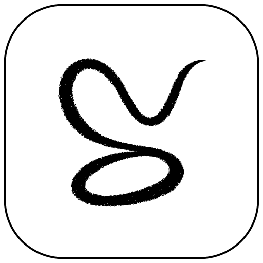

# Scriflow — name and symbol

**Scriflow** brings **scribe**, **script**, and **scribble** together with
**flow**. Writing is a way to think: drafting, calculating, working through a
derivation, or following an idea before it is fully formed. Flow expresses the
uninterrupted concentration the app aims to support. The name is written as
one word with an initial capital: **Scriflow**. Its tagline remains
**Handwriting for thinking.**



The current symbol is a flowing chalk-drawn **S**, connecting the name Scriflow
with the action in physics. Its loop and rising finish also evoke a path and an
integral. The light version is the default: black on white. A white-on-black
version is available for dark backgrounds.

The icon and derived branding are © 2026 Xing, all rights reserved, and are
not licensed under MIT. See the [icon rights notice](../LICENSE-ICON.md) before
using or redistributing this artwork.

## Artwork and regeneration

- [Source symbol](../assets/branding/scriflow-symbol.svg): a genuine SVG trace
  of the selected AI-generated [chalk reference](../assets/branding/scriflow-chalk-reference.png),
  with a transparent background; also available as a [512 px PNG](../assets/branding/scriflow-symbol.png).
- [Light icon](../assets/branding/scriflow-icon.svg) and
  [dark icon](../assets/branding/scriflow-icon-dark.svg): matching white and
  black rounded tiles, also available as [light PNG](../assets/branding/scriflow-icon.png)
  and [dark PNG](../assets/branding/scriflow-icon-dark.png). A white-on-transparent
  [dark-background symbol](../assets/branding/scriflow-symbol-dark.svg) is also provided.
- Android uses a compact [vector foreground](../assets/branding/scriflow-symbol-android.svg)
  with a white adaptive background, plus PNG
  fallbacks at 48, 72, 96, 144, and 192 px. The launcher's own mask supplies the
  adaptive icon's outer shape. Artwork fits inside its central safe area. An
  API-33 resource variant supplies the same symbol for themed launcher icons;
  the app's tested firmware target and API-29 build remain unchanged.
  The compact vector omits fine grains that disappear at launcher size. Night
  resources provide the white-on-black icon when the Android system theme and
  launcher support it; there is no in-app launcher-icon toggle. Some launchers
  cache icons and may keep displaying the previous variant after a theme change.

Edit `assets/branding/scriflow-symbol.svg` and, when the shape changes, its
compact Android counterpart `assets/branding/scriflow-symbol-android.svg`.
Regenerate the derived assets with Python 3.8+ and Inkscape installed:

```bash
python3 tools/build-branding.py
python3 tools/build-showcase-hero.py
```

The generated files are checked in, so building the app does not require
Inkscape. Android icon implementation follows the
[adaptive icon guidance](https://developer.android.com/develop/ui/compose/system/icon_design_adaptive).

## Rename and compatibility

Version **0.28.0-beta.2** adopts **Scriflow**, replacing **Scribblow**. New offline
builds are `build/scriflow-debug.apk`, signed release candidates are named
`scriflow-<version>.apk`, and new PDF exports identify Scriflow as their creator.
The first public beta, **0.28.0-beta.1**, was released as Scribblow; its APK,
checksum, tag, and historical acceptance record keep that name. Earlier PDFs
are not rewritten automatically. Version **0.27** originally replaced the
temporary **Ink Notebook** name with Scribblow.

The application ID and Java namespace remain `org.eink.inkprobe`. The permanent
public signing certificate, development signing key, notebook locations, file
formats, backup extension, and legacy page-ID derivation are preserved. The
old `ink-notebook:page:` identity prefix is part of storage compatibility. The
private release keystore's existing Scribblow filename and alias also remain
valid; a visible rename does not require a new key. Install the renamed build
as an update; do not uninstall the existing app to rename it.

The original **Ink Probe** experiment remains available in debug builds as
Scriflow's ink diagnostics. Release manifests exclude diagnostic entry points.
Its `InkProbe` log tag and JSON field names remain compatible with the existing
analysis tools. Public-release signing and migration are described in
[Releasing](releasing.md).
