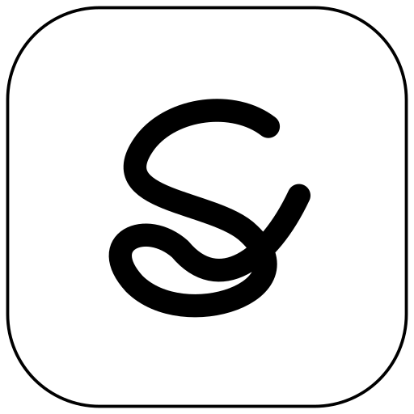

# Scribblow — name and symbol

**Scribblow** combines **scribble** and **flow**. Scribbling is a way to think:
drafting, calculating, working through a derivation, or following an idea before
it is fully formed. Flow expresses the uninterrupted concentration the app aims
to support. The name is written as one word with an initial capital: Scribblow.



The symbol is one continuous handwritten **S**. Its lower loop suggests a
working scribble; the open, rising finish expresses movement and continuation.
Rounded ends and a generous stroke keep it legible at small sizes. Black ink
and white paper suit the MatePad Paper display without gradients, shadows, or
color-dependent details.

## Artwork and regeneration

- [Source symbol](../assets/branding/scribblow-symbol.svg): scalable artwork with
  a transparent background, also available as a [512 px PNG](../assets/branding/scribblow-symbol.png).
- [Standalone icon](../assets/branding/scribblow-icon.svg): white rounded tile
  with a fine black keyline, also available as a [512 px PNG](../assets/branding/scribblow-icon.png).
- Android uses a vector foreground and a white adaptive background, plus PNG
  fallbacks at 48, 72, 96, 144, and 192 px. The launcher's own mask supplies the
  adaptive icon's outer shape. Artwork fits inside its central safe area. An
  API-33 resource variant supplies the same symbol for themed launcher icons;
  the app's tested firmware target and API-29 build remain unchanged.

Edit `assets/branding/scribblow-symbol.svg`, then regenerate with Python 3.8+ and
Inkscape installed:

```bash
python3 tools/build-branding.py
```

The generated files are checked in, so building the app does not require
Inkscape. Android icon implementation follows the
[adaptive icon guidance](https://developer.android.com/develop/ui/compose/system/icon_design_adaptive).

## Rename and compatibility

Version **0.27** adopts Scribblow as the app name, replacing the temporary
**Ink Notebook** name. New offline builds are `build/scribblow-debug.apk`, and
new PDF exports identify Scribblow as their creator. Earlier APK filenames and
historical diagnostic records retain their original names.

The application ID and Java namespace remain `org.eink.inkprobe`. The development signing
key, notebook locations, file formats, backup extension, and legacy page-ID
derivation are preserved. The old `ink-notebook:page:` identity prefix is part
of storage compatibility, not a visible brand string. Install the renamed build
as an update; do not uninstall the existing app to rename it.

The original **Ink Probe** experiment remains available in debug builds as
Scribblow's ink diagnostics. Release manifests exclude diagnostic entry points.
Its `InkProbe` log tag and JSON field names remain compatible with the existing
analysis tools. Public-release signing and migration are described in
[Releasing](releasing.md).
